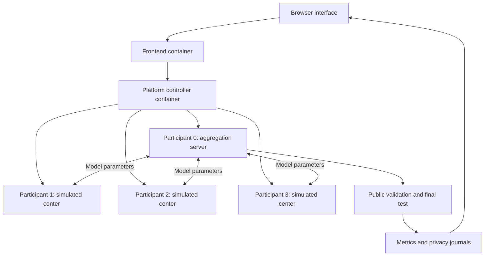

# Federated Breast Tumor Classification with Adaptive Differential Privacy

An experimental project built on [NEBULA by CyberDataLab](https://github.com/CyberDataLab/nebula). Three simulated medical centers train a breast tumor classifier through federated learning. The experiments compare training without differential privacy, fixed DP-SGD, and DP-SGD with public-reference adaptive clipping.

**Authors:** Mateo Oñate and Demian Viteri, Yachay Tech University.

The application processes the 30 numerical features in the public Wisconsin Diagnostic Breast Cancer dataset. It classifies records as malignant or benign. It does not process mammograms, collect patient records, or represent three independent clinical institutions.

## Contents

- [How NEBULA works](#how-nebula-works)
- [Repository structure](#repository-structure)
- [Requirements](#requirements)
- [Installation and startup](#installation-and-startup)
- [Running the three experiments](#running-the-three-experiments)
- [Adaptive differential privacy](#adaptive-differential-privacy)
- [Reading and exporting results](#reading-and-exporting-results)
- [Recorded results](#recorded-results)
- [Tests](#tests)
- [Troubleshooting](#troubleshooting)
- [Uploading to GitHub](#uploading-to-github)
- [References and attribution](#references-and-attribution)

## How NEBULA works

NEBULA manages the participants, communication, training rounds and aggregation in a federated learning experiment. This project follows centralized federated learning, or CFL, with a star topology.

The **platform controller** and the **model aggregation server** perform different jobs:

| Component | Responsibility |
| --- | --- |
| Browser interface | Configures experiments, monitors execution, compares metrics and exports evidence. |
| Frontend container | Serves the interface and manages the sequence of submitted scenarios. |
| Controller container | Prepares configurations, partitions the public benchmark, generates communication certificates and starts participant containers. |
| Participant 0, aggregation server | Distributes the global model, combines client updates through FedAvg and evaluates the aggregated model. |
| Participants 1, 2 and 3, trainers | Load their assigned training partitions, perform local optimization and send updated model parameters. |



### What happens during an experiment

1. `app/main.py` starts the management services through Docker. The local browser interface is available at `http://localhost:6060`.
2. A scenario defines the dataset, topology, participants, aggregation method, rounds, epochs and privacy controls.
3. The controller creates the configurations and HDF5 partitions, then starts one server and three trainers.
4. At each round, the trainers receive the global model and train on their assigned records. Private modes clip individual gradients, add Gaussian noise and update a persistent privacy accountant.
5. The server combines the returned parameters through FedAvg, weighted by the local training-set sizes.
6. The server evaluates the aggregated model on the public reference set after each round. A separate final test appears after the last aggregation.
7. The results page reads the evaluation and privacy journals. Completed scenarios retain their evidence after participant containers stop.

The simulation runs on one computer with shared project mounts. Each trainer's code loads its assigned partition, but the setup does not enforce filesystem isolation between real hospitals. Differential privacy protects the training-update channel under the documented assumptions. It is a statistical mechanism, separate from transport encryption.

## Repository structure

```text
NEBULA/
├── README.md                       Project overview and operating guide
├── LICENSE                         Original NEBULA AGPL license
├── NOTICE.md                       Origin, authorship and modifications
├── CITATION.cff                    Citation metadata
├── pyproject.toml                  Dependency declarations
├── uv.lock                         Locked dependency resolution
├── Dockerfile.cpu                  CPU images for all three components
├── app/                            Platform launcher
├── nebula/                         Full framework and project modifications
├── scripts/                        Setup, startup, checks and evidence tools
├── tests/                          Privacy, lifecycle and frontend checks
│   └── fixtures/legacy_v2/          Source snapshot for migration tests
├── configs/scenarios/              Baseline, fixed and adaptive presets
├── requirements/                   Exported host and container dependencies
├── results/                        Preserved measured evidence
│   ├── nebula_v3_20261104/          Full NEBULA experiment exports
│   ├── smoke_v3_20261104/           Independent CPU integration checks
│   └── history/                    Earlier pilots and scheduled-noise results
├── provenance/                     Source hashes and validation records
├── docs/project/                   Protocol and reproducibility notes
├── docs/upstream/                  Original upstream repository documents
└── archive/                        Original development material and proposal
```

Runtime state is generated under `app/config`, `app/logs`, `app/databases` and `app/certs`. Local environments, generated credentials and temporary test files are excluded from Git. The framework source, static frontend assets, setup tools and recorded public-data evidence are included.

## Requirements

| Requirement | Project configuration |
| --- | --- |
| Operating system | Linux x86-64, or Ubuntu under WSL 2 on Windows |
| Containers | Docker Engine on Linux, or Docker Desktop with the WSL 2 backend and Ubuntu integration |
| Python | 3.11.13, installed locally by the setup script through uv |
| Dependency manager | uv 0.8.22, downloaded from PyPI with wheel checksum verification |
| Compute | CPU execution, no GPU required |
| Network access | Required for the first Python/package/image installation |
| Optional test tooling | Node.js 22 for the frontend JavaScript checks |

The reference laptop had an Intel Core i3-1005G1, 8 GB of physical RAM and approximately 3.74 GiB allocated to WSL. Four training processes plus the management services put pressure on this allocation. Startup and image builds take longer than the measured training rounds. Experiments should run sequentially.

Docker Desktop must expose its Linux engine to the Ubuntu distribution. The [official Docker WSL guide](https://docs.docker.com/desktop/features/wsl/) describes this setting. A native Windows Python environment is not the supported platform launcher.

`pyproject.toml` declares the dependencies. `uv.lock` fixes their resolved versions. The files under `requirements/` provide readable exports for the host and container environments. Setup and Docker builds check the lock rather than silently resolving new versions. See the [uv documentation](https://docs.astral.sh/uv/concepts/projects/sync/).

## Installation and startup

### From a Git checkout in Linux or Ubuntu

Clone this repository into the Linux filesystem, then run the following commands from its root:

```bash
bash scripts/setup.sh
bash scripts/test.sh
bash scripts/run.sh
```

Setup creates a local Python environment and builds `nebula-project2-core`, `nebula-project2-controller` and `nebula-project2-frontend`. The images share a CPU dependency layer. The first build downloads packages and base-image layers.

When startup finishes, visit:

```text
http://localhost:6060
```

The original local demonstration account is `admin` with password `admin`. Keep the management ports local. The launcher binds the host management ports to loopback.

### From a downloaded folder stored on Windows

In an Ubuntu terminal, enter the downloaded `NEBULA` directory and run:

```bash
bash scripts/install_wsl.sh
```

This copies the distributable project into `$HOME/NEBULA` and runs setup there. An unrelated existing directory is preserved. Select another destination when necessary:

```bash
NEBULA_PROJECT_DIR="$HOME/NEBULA-research" bash scripts/install_wsl.sh
```

Then enter the installation directory:

```bash
cd "$HOME/NEBULA"
bash scripts/test.sh
bash scripts/run.sh
```

If a different destination was selected, enter that destination instead. The copier does not copy local virtual environments, runtime credentials, databases, or generated logs from another installation.

### Restart and stop

Keep the terminal running while the platform is needed. Press Ctrl+C in that terminal for a normal shutdown. To start it again:

```bash
cd "$HOME/NEBULA"
bash scripts/run.sh
```

The saved scenario configurations and logs remain in the installation. Generated certificates and application state are not repository inputs.

## Running the three experiments

The presets in `configs/scenarios/` can be imported through the deployment page. Each creates one server and three trainers.

| Setting | Initial demonstration |
| --- | --- |
| Deployment | Docker |
| Federation and topology | CFL, Star |
| Participants | 4 total, node 0 server with Start enabled, nodes 1–3 trainers |
| Dataset | BreastCancer, WDBC |
| Distribution | Non-IID, Dirichlet alpha 0.5 |
| Model and aggregation | MLP, FedAvg |
| Accelerator | CPU |
| Training | 3 rounds, 1 local epoch per round |
| Other mechanisms | Attacks, reputation, mobility and additional training defenses disabled |

Import and run `baseline.json`, `fixed.json` and `adaptive.json` sequentially. The private presets share epsilon limit 8, delta 0.00001 and initial C = 1. Fresh scenario names keep each privacy history separate.

The benchmark splits 569 public records into 364 training records, 91 public calibration/validation records and 114 final-test records. Labels follow scikit-learn: **0 is malignant and 1 is benign**. The scaler fits only the public reference records.

With the recorded seed 42 and alpha 0.5, the trainer partitions contain 17, 55 and 292 records. This varies both class proportions and center sizes. It is a useful functional demonstration, but a publication should separate those effects before attributing changes to heterogeneity alone.

## Adaptive differential privacy

Fixed DP-SGD keeps both sigma and the clipping limit C constant. The adaptive mode keeps sigma constant and adjusts C from the current model's gradient norms on the designated public reference records.

```text
target = clamp(quantile(public gradient norms), C_min, C_max)
C_round = (1 - weight) * C_previous + weight * target
noise standard deviation on the clipped sum = sigma * C_round
```

The default quantile is 0.5, or the median. The smoothing weight is 0.5 and C stays between 0.1 and 5. The controller recalculates its target at each round. It does not follow a predetermined decreasing sequence.

The initial model is independent of private records. Later reference calculations take the incoming model from previous private updates. The controller reads public examples, not private training gradient statistics or final-test records. Opacus clips private individual gradients and adds Gaussian noise scaled to the selected C. One RDP accountant persists across all rounds for each client.

This implementation is **public-reference adaptive clipping**. It does not reproduce a method which privately estimates a quantile of the clients' private gradients. It does not claim a new cryptographic primitive or a new adaptive-clipping algorithm.

The budget describes conditional record-level training accounting with fixed public synthetic allocation and sizes. It does not cover hospital-level participation or the label-dependent allocation procedure. The reference set also serves validation and is not an independent generalization test. Experimental RNG remains explicitly labelled. Secure RNG requires a compatible `torchcsprng` installation and a separate deployment review.

Implementation details are in [the protocol guide](docs/project/ADAPTIVE_PRIVACY.md).

## Reading and exporting results

Open **Privacidad y resultados · Project 2** from a scenario monitor. The Spanish interface includes:

- Epsilon accumulated per client, with its configured ceiling.
- Sigma, clipping limit C and the applied sigma-times-C noise scale.
- A table of adaptation decisions and the number of public reference records.
- Public-validation curves and separate final-test metrics.
- A confusion matrix with malignant records treated as the positive class.
- Comparisons between compatible configurations and JSON/CSV downloads.

| Metric | Interpretation |
| --- | --- |
| Accuracy | Fraction of all test records classified correctly. |
| Malignant recall | Fraction of actual malignant records detected as malignant. |
| Malignant F1 | Balance between malignant precision and recall. |
| ROC-AUC | Ranking performance from malignant scores across thresholds. |
| Epsilon | Accumulated privacy bound, not a disclosure percentage. |
| Sum of round times | Recorded round durations, excluding full installation and platform startup. |

One CSV row represents one participant in one round. Nine privacy rows mean three clients times three rounds. Repeated final metrics refer to one global model, not independent repetitions.

For scripted collection from a running local platform:

```bash
python scripts/collect_evidence.py \
  --title WDBC_V3_BASE_DEMO \
  --title WDBC_V3_FIXED_DEMO \
  --title WDBC_V3_ADAPTIVE_DEMO \
  --output results/generated/my-comparison
```

The collector prompts for the local password unless `NEBULA_DEMO_PASSWORD` is set in the terminal. It collects existing scenarios and does not submit new experiments. New generated results remain local until they are reviewed for inclusion in the repository.

## Recorded results

The following are real NEBULA container runs from November 4, 2026, with three rounds and one local epoch. They are separate from the independent CPU smoke checks.

| Condition | Accuracy | Malignant recall | Malignant F1 | Maximum epsilon |
| --- | ---: | ---: | ---: | ---: |
| Without DP | 94.7% | 97.6% | 93.2% | No DP bound |
| Fixed DP | 82.5% | 52.4% | 68.8% | 7.941 |
| Adaptive DP | 83.3% | 54.8% | 70.8% | 7.941 |

The adaptive model detected 23 of 42 malignant records. Fixed DP detected 22, and the non-private model detected 41. These are single exploratory runs, not averages or evidence of statistical superiority. They do not establish clinical validity.

The [recorded evidence](results/nebula_v3_20261104/) includes the excluded Docker startup failure and the successful fixed-DP retry. Earlier scheduled-noise results keep their original meaning under `results/history/`. Historical evidence retains the timestamps and paths recorded at execution time.

The final test has already been inspected during exploratory work. A publication needs an evaluation protocol which separates parameter selection from final assessment, repeated comparisons and an explicit privacy analysis.

## Tests

After setup:

```bash
bash scripts/test.sh
```

The privacy suite checks actual Opacus rounds, cumulative accounting, step guards, public-reference adaptation, data splits and malignant-class metrics. HDF5 and NEBULA Lightning integration require the installed Linux dependencies. The release suite checks source hashes, migration safety, queue ordering, container failures and scenario-scoped cleanup. Optional Node.js checks cover controls, historical labels, comparisons and CSV evidence.

The November 4 installation passed eight privacy tests and nine release/lifecycle tests in Ubuntu. The packaging checks for this repository are recorded separately in [package validation](provenance/package_validation.json). Dependency locking and directory reorganization do not retroactively change the historical training environment or results.

For a standalone CPU integration check, without Docker participants:

```bash
.venv/bin/python scripts/research_smoke.py --output results/generated/smoke-check
```

Keep each output directory new. A smoke check verifies the local training path. It is not a full NEBULA networking experiment.

The GitHub Actions workflow runs the repository, release and JavaScript checks. It does not deploy the platform or claim to replace the full local training tests.

## Troubleshooting

| Symptom | Check |
| --- | --- |
| Docker unavailable in Ubuntu | Start Docker Desktop and enable integration for the Ubuntu distribution. |
| Setup is running from a Windows-mounted directory | Run `bash scripts/install_wsl.sh`, then work in the Linux copy. |
| Management ports already occupied | Stop the other NEBULA instance before starting a second one. |
| Old DP controls remain visible | Refresh the deployment page with Ctrl+F5. |
| Scenario stays in Running | Inspect the participant state, evaluation journals and startup errors. Running alone does not prove training progress. |
| Sigma is flat in adaptive mode | Expected. Inspect the C and sigma-times-C plots for adaptation. |
| High accuracy but poor malignant recall | Read the confusion matrix and false-negative count. |
| CSPRNG option fails | The optional `torchcsprng` dependency is not installed by the default CPU setup. |

More commands and recovery details are in [operations](docs/project/OPERATIONS.md).

## Uploading to GitHub

The contents of this `NEBULA` directory form the repository root. Upload this directory's contents, including `app/`, `nebula/`, `uv.lock`, `LICENSE` and the dotfiles. The parent workspace contains other projects and is not part of this repository.

The `.gitignore` excludes generated runtime state and local dependencies. Original development scripts and proposal material are labelled as historical under `archive/`. Set the Git remote to the repository created for this project.

Follow [the GitHub preparation steps](docs/project/GITHUB.md) to connect an empty remote and push a reviewed commit.

## References and attribution

- [NEBULA, CyberDataLab](https://github.com/CyberDataLab/nebula), base commit `525b31c674644c653117126b5a1473a5321ac240`. The original framework license is preserved in [LICENSE](LICENSE), with changes described in [NOTICE.md](NOTICE.md).
- [Wisconsin Diagnostic Breast Cancer, UCI](https://archive.ics.uci.edu/dataset/17/breast+cancer+wisconsin+diagnostic), dataset DOI [10.24432/C5DW2B](https://doi.org/10.24432/C5DW2B).
- McMahan et al., [Communication-Efficient Learning of Deep Networks from Decentralized Data](https://proceedings.mlr.press/v54/mcmahan17a.html), AISTATS 2017.
- Abadi et al., [Deep Learning with Differential Privacy](https://arxiv.org/abs/1607.00133), 2016.
- Andrew et al., [Differentially Private Learning with Adaptive Clipping](https://papers.nips.cc/paper_files/paper/2021/hash/91cff01af640a24e7f9f7a5ab407889f-Abstract.html), NeurIPS 2021. Its private user-level quantile method differs from this public-reference controller.
- [Opacus DPOptimizer](https://opacus.ai/api/optim/dp_optimizer.html) and [PrivacyEngine](https://opacus.ai/api/privacy_engine.html) documentation.
